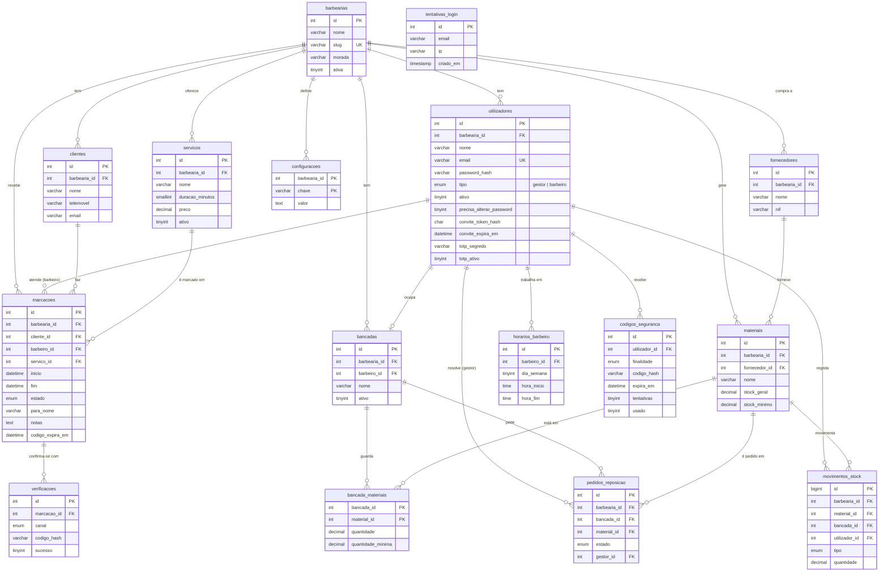

# BarberFlow — Base de dados

**SGBD:** MariaDB (MySQL) · **BD:** `esan-dsg09` · **Motor:** InnoDB (chaves estrangeiras e transações) · **Charset:** `utf8mb4`

A aplicação é **multi-tenant**: várias barbearias partilham a mesma BD e quase todas as tabelas têm `barbearia_id`.
Todas as consultas filtram por esse campo, por isso uma barbearia nunca vê os dados de outra.

## Diagrama entidade-relação

Por legibilidade, o diagrama mostra só as colunas principais de cada tabela. A lista completa está na secção seguinte.



## Tabelas

| Tabela | Para que serve | Notas |
|---|---|---|
| `barbearias` | Cada barbearia cliente do BarberFlow | O `slug` (ex.: `rlbarber`) identifica a barbearia no site e na app |
| `utilizadores` | Contas da gestão: **gestor** e **barbeiro** | Senha em `password_hash` (bcrypt). Colunas de segurança: convite (`convite_token_hash` = sha256 do link, `convite_expira_em`) e 2FA (`totp_segredo`, `totp_ativo`) |
| `clientes` | Quem marca pelo site ou pela app | Único por barbearia + telemóvel; não tem senha (confirma-se com um código) |
| `servicos` | Catálogo (corte, barba…) com duração e preço | `ativo = 0` esconde sem apagar o histórico |
| `marcacoes` | Agenda | Estados: `pendente_verificacao` → `confirmada` → `concluida` / `cancelada` / `expirada`. `para_nome`: marcação feita para outra pessoa |
| `verificacoes` | Histórico dos códigos enviados para confirmar marcações | Só o hash do código |
| `configuracoes` | Definições de cada barbearia (chave → valor) | Horário, dias de abertura, tema, antecedência para cancelar… Chave primária (`barbearia_id`, `chave`) |
| `horarios_barbeiro` | Janelas de trabalho de cada barbeiro por dia da semana | Usadas para calcular os horários livres |
| `bancadas` / `bancada_materiais` | Posto de cada barbeiro e o material que lá está | Um barbeiro tem no máximo uma bancada |
| `materiais` / `fornecedores` | Stock geral da barbearia e de quem se compra | |
| `pedidos_reposicao` | Barbeiro pede material; gestor aprova, entrega ou rejeita | |
| `movimentos_stock` | Auditoria das entradas, transferências e perdas | |
| `codigos_seguranca` | Códigos de 6 dígitos para **mudar** ou **recuperar** a senha | Só o hash; 15 min; 5 tentativas; uso único |
| `tentativas_login` | Logins falhados por email e IP | Bloqueia depois de 5 falhas por email ou 20 por IP em 15 min; limpa-se ao fim de 1 dia |

## Vista `vw_agenda`

Junta numa só "tabela virtual" a marcação, o cliente, o serviço e o barbeiro. O módulo **Agenda** lê dela, em vez de repetir os JOIN em cada consulta.

```sql
CREATE OR REPLACE VIEW vw_agenda AS
SELECT m.id, m.barbearia_id, m.barbeiro_id, m.inicio, m.fim, m.estado, m.notas, m.para_nome,
       c.nome AS cliente_nome, c.telemovel AS cliente_telemovel, c.email AS cliente_email,
       s.nome AS servico_nome, s.duracao_minutos, s.preco AS servico_preco, u.nome AS barbeiro_nome
FROM marcacoes m
JOIN clientes     c ON c.id = m.cliente_id  AND c.barbearia_id = m.barbearia_id
JOIN servicos     s ON s.id = m.servico_id  AND s.barbearia_id = m.barbearia_id
JOIN utilizadores u ON u.id = m.barbeiro_id AND u.barbearia_id = m.barbearia_id;
```

Os JOIN incluem `barbearia_id` como segunda proteção multi-tenant. A consulta da agenda filtra sempre a vista por `barbearia_id` e, no perfil barbeiro, também por `barbeiro_id`.

## Ficheiros SQL

| Ficheiro | O que faz |
|---|---|
| Dump inicial `esan-dsg09` | Estrutura e dados de base. **Não está no repositório**, porque tem dados reais; a BD da UA já o tem |
| `sql/2026-11-10_movimentos_stock.sql` | Tabela de auditoria do stock |
| `sql/2026-11-11_marcacoes_para_nome.sql` | Coluna `marcacoes.para_nome` |
| `sql/2026-11-13_seguranca_contas.sql` | Convites, 2FA, `codigos_seguranca`, `tentativas_login` e `vw_agenda` (pode repetir-se) |
| `sql/utilizadores_teste.sql` | Contas de teste para a avaliação (na barbearia de demonstração) |

## Acesso à BD no código

- Ligação única por **PDO** (`config/db.php`), com `ERRMODE_EXCEPTION` e `EMULATE_PREPARES = false`.
- **Todas** as consultas com valores do utilizador usam *prepared statements* (`?`); nunca se concatena input em SQL.
- Classes por entidade em `objects/` (`Servico`, `Fornecedor`, `Bancada`, `Configuracao`) com `read`, `readOne`, `create` e `update`, cada uma presa a uma `barbearia_id`.
- Operações que mexem em várias linhas (criar ou remarcar marcações, stock) correm em **transações**, com `SELECT … FOR UPDATE` onde há concorrência.
